# Discord Decor: UI screenshots

Every picture here comes from a clean test SillyTavern holding only made-up sample data: non-human characters drawn for these screenshots, and sample chats. Animated pictures play by themselves.

This plugin has no screen of its own. It powers Offline Copies and the profile art in the [Discord theme](https://github.com/pervertir/SillyTavern-Discord).

## Offline Copies

Keep the art on your own SillyTavern server: every kind, the ones in use, or item by item, with a size breakdown first. Use only saved copies stops loading from Discord.

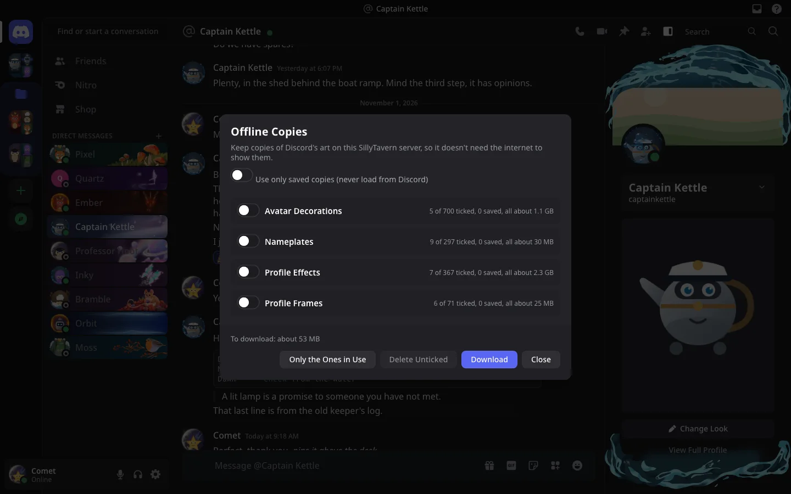

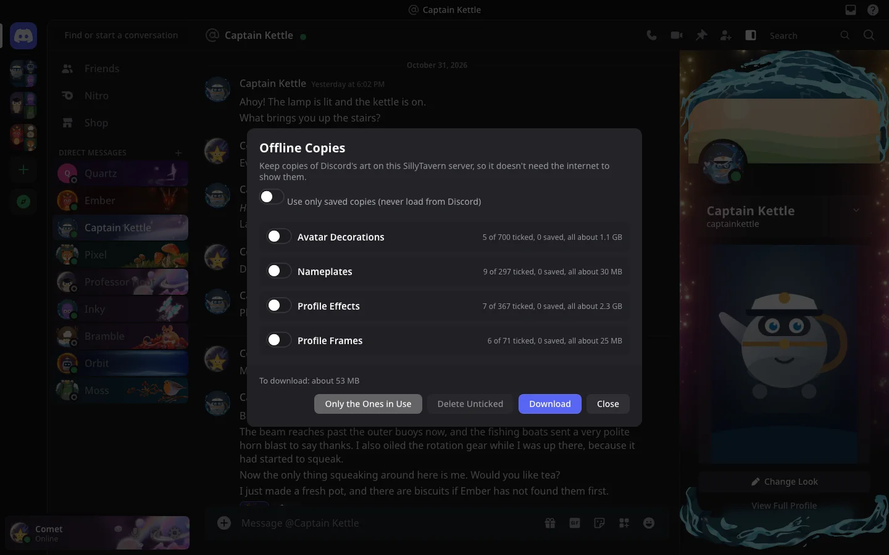

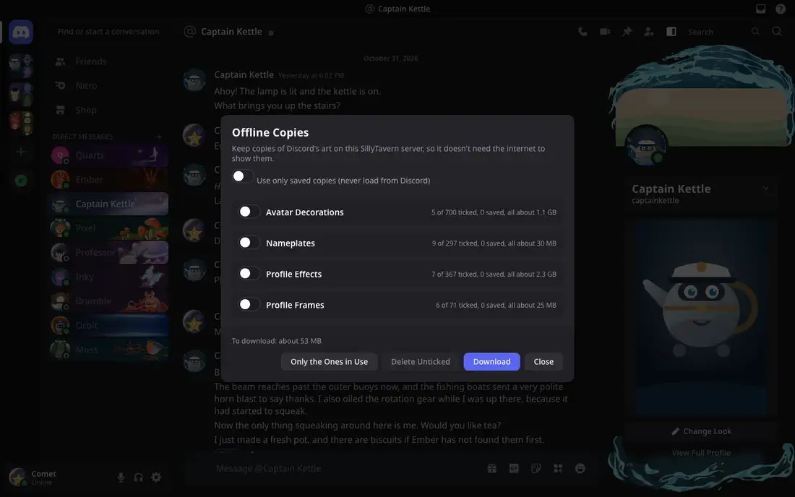

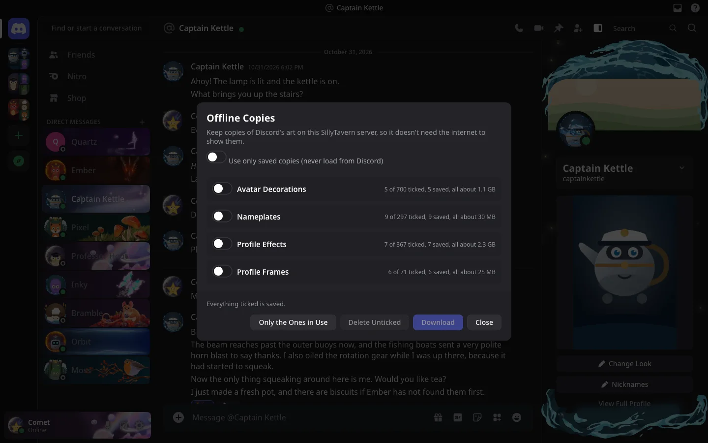

## Worn everywhere

The avatar decoration sits around the picture, the nameplate behind the name in the DM and member lists, and the effect and frame on the profile.

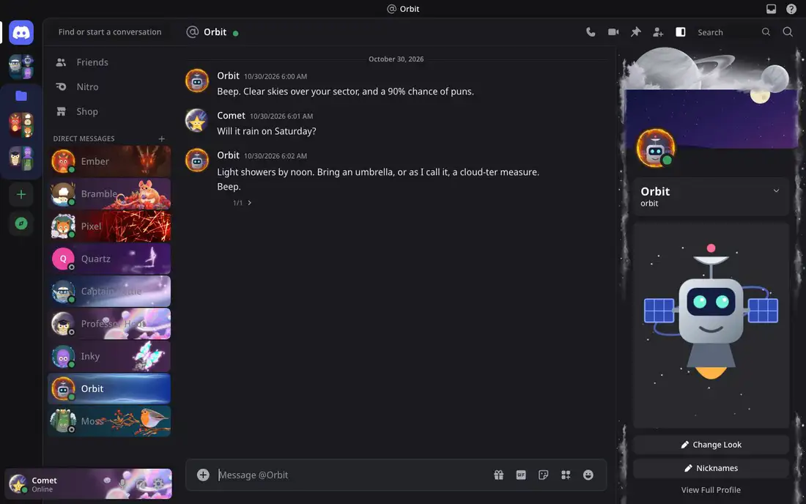

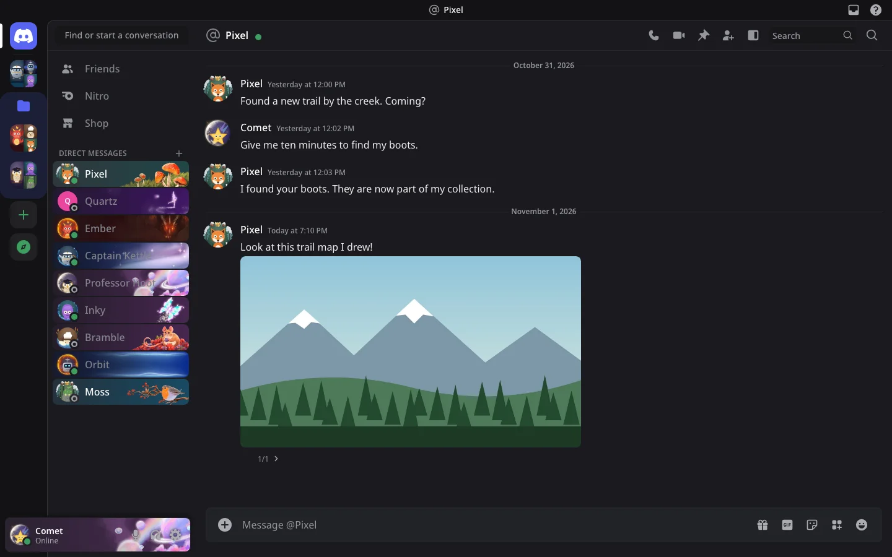

## Change Look

Change Look on a profile swaps what someone wears, with search. Lists show stills and play on hover; each person keeps their own items.

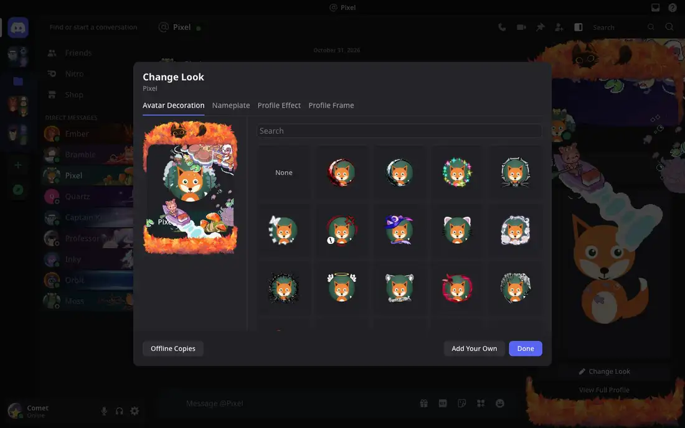

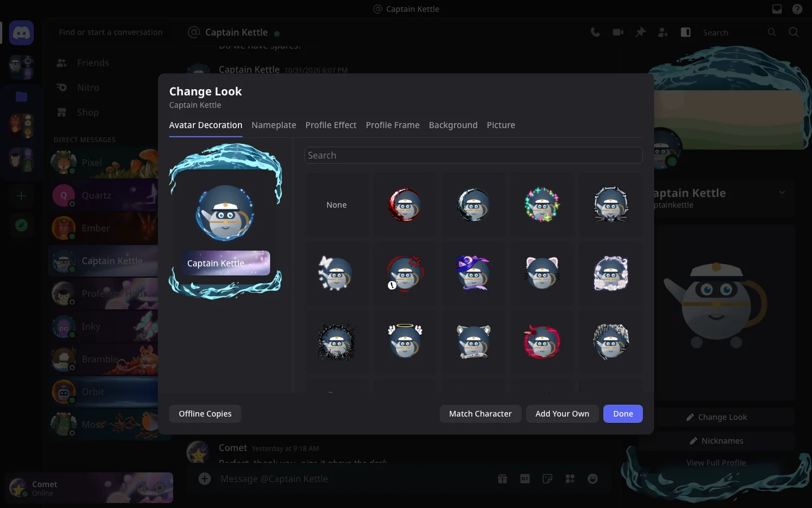

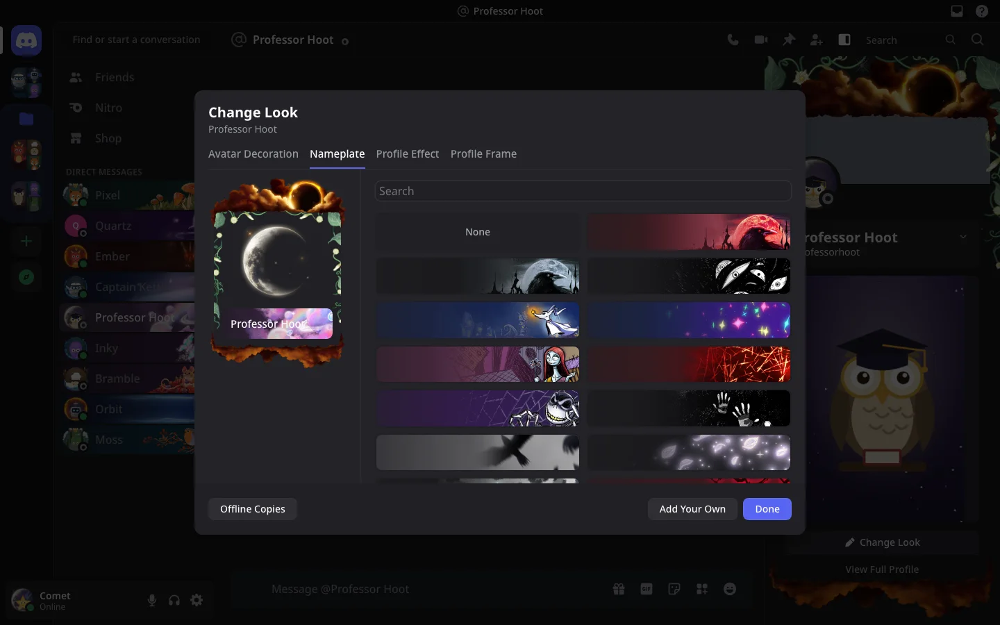

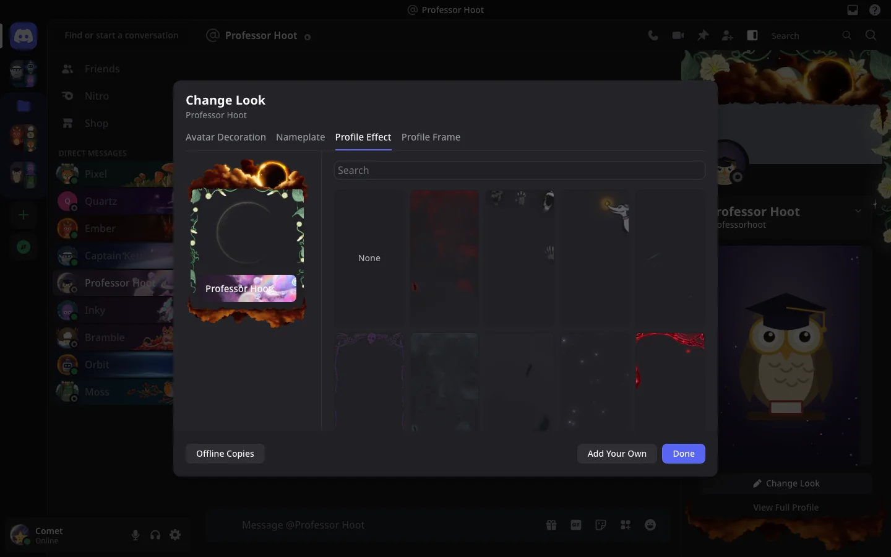

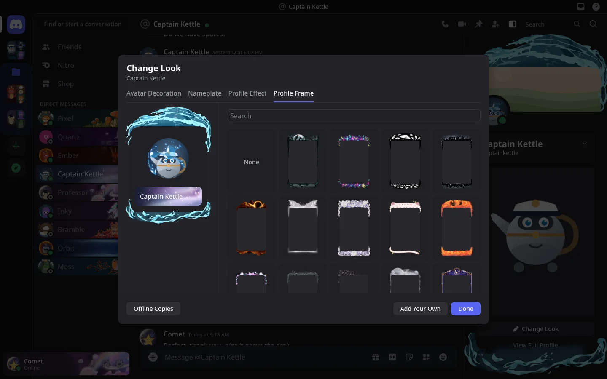

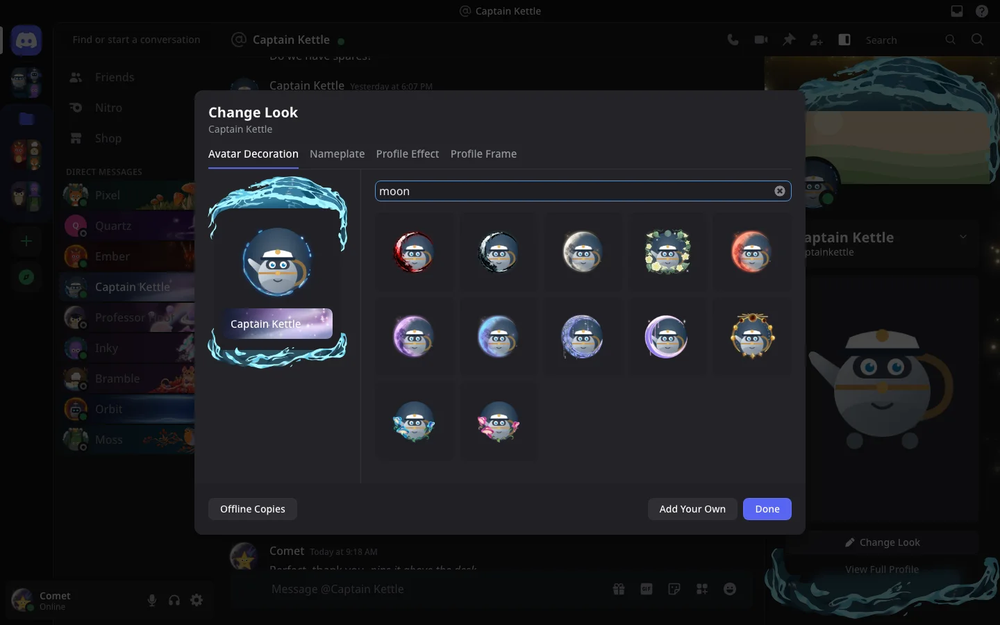

